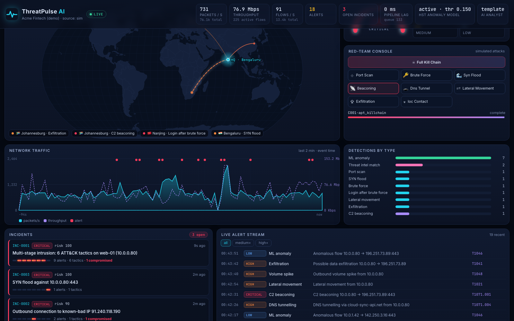
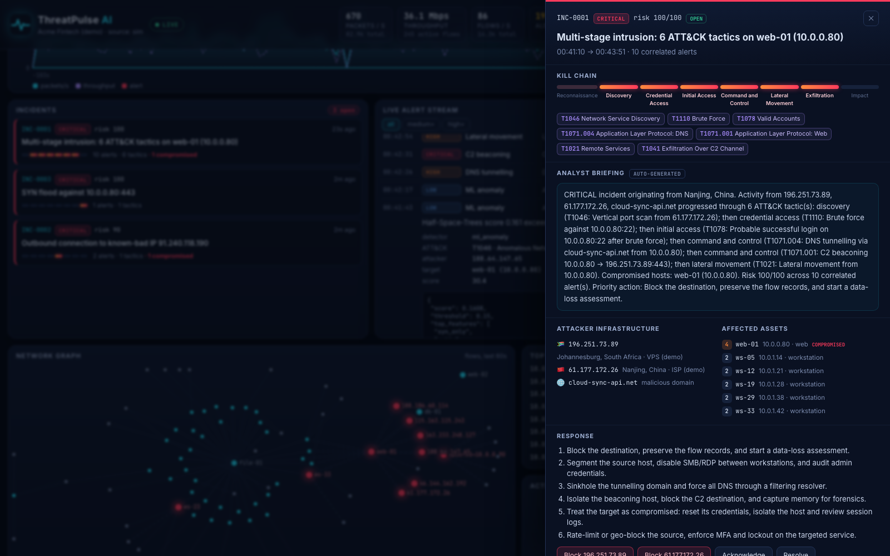
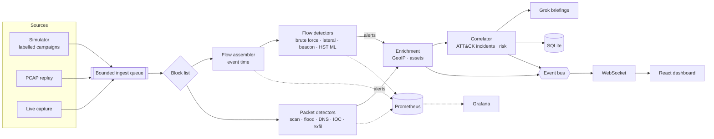

<div align="center">


# ThreatPulse AI

### Real-Time Cyber Threat Detection & Intelligence Engine

**Streams network traffic, detects attacks with rules, behavioural analytics and online ML,<br/>correlates them into MITRE ATT&CK kill-chain incidents, and visualises everything live.**

[](https://github.com/coolstack-coder/ThreatPulse-AI-Real-Time-Cyber-Threat-Detection-Intelligence-Engine/actions/workflows/ci.yml)


**100% recall** on 27 simulated attack campaigns · **0 false-positive incidents** in 1.5 h of benign traffic · **68k packets/s** with ML on a laptop

</div>

---

## 🎬 Demo


> **[▶ Watch the full-quality recording (MP4, 1:51)](docs/media/demo.mp4)**. The dashboard was recorded with Playwright while
> the engine ran. In it, a full APT kill chain is launched from the red-team console: port scan → SSH brute force → successful login →
> C2 beaconing → DNS tunnelling → lateral movement → exfiltration. ThreatPulse detects every stage, folds them into **one critical
> incident across 6 ATT&CK tactics**, and the analyst blocks the attacker from the incident drawer.

| Live SOC dashboard | Incident investigation |
|---|---|
|  |  |

---

## 📌 Table of contents
1. [The problem](#-the-problem)
2. [What ThreatPulse does](#-what-threatpulse-does)
3. [Measured results](#-measured-results)
4. [Architecture](#-architecture)
5. [How the detection works](#-how-the-detection-works)
6. [Quick start](#-quick-start)
7. [Using it](#-using-it)
8. [Codebase walkthrough](#-codebase-walkthrough)
9. [Testing & quality gates](#-testing--quality-gates)
10. [Observability](#-observability)
11. [Configuration](#-configuration)
12. [Limitations & roadmap](#-limitations--roadmap)

---

## 🔥 The problem

Attackers are rarely invisible. They are just **unnoticed**. According to IBM's *Cost of a Data Breach 2025*, the mean time to
**identify** a breach is **181 days**, the average breach costs **$4.44M**, and organisations that use security AI and
automation extensively shorten the breach lifecycle by roughly **80 days**.

Almost every intrusion leaves network evidence weeks before the damage: recon scans, password spraying, C2 heartbeats,
lateral SMB sessions, a database server suddenly uploading 40 MB to a VPS. Teams still miss it because:

| Pain | Why it happens | How ThreatPulse answers |
|---|---|---|
| **Volume** | Millions of flows per hour, and no human reads them | Streaming pipeline, O(1) per-packet state, bounded memory |
| **Fragmentation** | Each attack stage looks harmless on its own | **Kill-chain correlation**: alerts → one incident through entity pivots |
| **Alert fatigue** | Rule IDSs fire thousands of uncorrelated alerts | Cooldowns, destination rarity, ML treated as *supporting* evidence only, risk-ranked incidents |
| **Unknown attacks** | Signatures only catch what's already known | **Online ML (Half-Space Trees)** that learns *normal* and adapts to drift |
| **No explanation** | Black-box verdicts don't help an on-call engineer | Every alert carries its evidence; incidents get an analyst briefing (Grok LLM or template) |

The full research write-up is in **[docs/ANALYSIS.md](docs/ANALYSIS.md)**: existing tools (Snort/Suricata, Zeek/RITA, SIEMs, commercial NDR)
and the gap this project fills.

---

## ✨ What ThreatPulse does

| Capability | Details |
|---|---|
| **Ingest** | Live capture (scapy), PCAP replay, or a **labelled traffic simulator** of a 48-host company network |
| **Flow analytics** | Bidirectional flows with TCP state, idle/active timeouts, CICFlowMeter-style features, all on **event time** |
| **10 detectors, 4 layers** | Rules (port scan, SYN flood, brute force + login success, lateral movement, exfiltration) · Behaviour (C2 beacon periodicity, DNS tunnel entropy) · Threat intel (IP/CIDR/domain IOCs) · **Online ML** (Half-Space Trees, EWMA volume baseline) |
| **Correlation** | Entity-pivot incident building with merge semantics, MITRE ATT&CK mapping, kill-chain progress, asset-aware risk score |
| **Enrichment** | GeoIP (offline demo table or MaxMind), asset inventory with criticality, response playbooks |
| **AI analyst** | Optional **Grok** (xAI) incident briefings, debounced and with a deterministic fallback |
| **Response** | Block list enforced at ingest (SOAR-lite), with generated `iptables`/`nft` commands |
| **Live dashboard** | Attack map, traffic chart, threat gauge, incident queue, alert stream, force-directed network graph, red-team console |
| **Production hygiene** | Bounded queues and backpressure, Prometheus metrics + Grafana dashboard, health checks, SQLite WAL persistence, Docker, CI with a **detection-quality gate** |

---

## 📊 Measured results

Because the simulator labels every packet, detection quality is **measured**, not claimed. `threatpulse evaluate --seeds 3`
runs every scenario three times on top of realistic benign traffic ([full report](docs/EVALUATION.md)):

| Scenario | Recall | Median time-to-detect* | One incident | ATT&CK tactics |
|---|:-:|:-:|:-:|:-:|
| Port scan | 100% | 0.2 s | ✅ | 1 |
| SSH brute force → login | 100% | 8.3 s | ✅ | 2 |
| SYN flood (spoofed) | 100% | 1.2 s | ✅ | 1 |
| C2 beaconing (jittered) | 100% | 35.1 s | ✅ | 1 |
| DNS tunnelling | 100% | 1.8 s | ✅ | 1 |
| Lateral movement | 100% | 3.7 s | ✅ | 1 |
| Data exfiltration | 100% | 12.5 s | ✅ | 1 |
| Known-bad IOC contact | 100% | 0.0 s | ✅ | 1 |
| **Full APT kill chain** | **100%** | **0.2 s** | ✅ | **6** |

* **False positives:** 0 medium+ alerts and **0 incidents** across 1.5 hours of benign traffic (browsing, SMB, LDAP, a public web tier,
  periodic SaaS telemetry, NTP, legit cloud uploads, admin SSH).
* **Throughput** (`threatpulse benchmark`, MacBook, single core):

  | Mode | Packets/s | Flows/s |
  |---|--:|--:|
  | All detectors + Half-Space Trees ML | **68,482** | 9,654 |
  | Rules/behaviour/intel only | 176,679 | 24,907 |

<sub>*Time-to-detect is event time from the first malicious packet. Beaconing needs ~8 check-ins and exfiltration needs 20 MB before
they're statistically meaningful, so their latency reflects how those attacks unfold.</sub>

---

## 🏗 Architecture



The core (`Processor`) is **synchronous, pure and deterministic**: packet in, alerts out, no I/O. The same code drives the live
engine, PCAP replays, the evaluation harness, the benchmark and the unit tests. The async `Engine` wraps it with a producer/consumer
pair joined by a bounded queue, so a traffic burst is counted as drops in the metrics instead of exhausting memory.

👉 Deep dive with every design trade-off: **[docs/ARCHITECTURE.md](docs/ARCHITECTURE.md)**

---

## 🧠 How the detection works

<details open>
<summary><b>Stateful rules</b>: attack <i>shapes</i> that still show up when traffic is encrypted</summary>

| Detector | Signal | Key false-positive guard |
|---|---|---|
| **Port scan** (T1046) | ≥25 ports on one host or ≥30 host:port pairs in 10 s | SYN-ACK reply ratio < 50%. A busy browser connects a lot, but almost everything answers |
| **SYN flood** (T1498) | ≥400 SYNs to one *service* (host:port) in 5 s, < 30% answered | Keyed by service, so a scan spread across ports doesn't trip it |
| **Brute force** (T1110) | ≥12 short, small sessions to an auth port in 60 s | Long sessions don't count as attempts |
| **…→ login success** (T1078) | A long, data-heavy session from the same source right after a burst | Only within 10 min of a burst. Marks the host **compromised** |
| **Lateral movement** (T1021) | Internal host → ≥5 internal hosts over SMB/RDP/WinRM/SSH in 120 s | Admin jump hosts are allow-listed in the asset inventory |
| **Exfiltration** (T1041) | ≥20 MB outbound in 5 min, out/in ratio ≥8×, measured *per packet* in 10 s buckets | Destination **rarity** ≤2 internal hosts: uploads to Google Drive don't fire |
</details>

<details open>
<summary><b>Behavioural analytics</b>: timing and information theory</summary>

* **C2 beaconing** (T1071.001). Implants call home on a timer. For each `(host, dst, port)` ThreatPulse keeps the start times of
  recent connections and computes the **coefficient of variation** of the gaps (σ/μ). A CV under 0.25 means periodic even with 10%
  jitter. Two guards: the destination must be **rare** (SaaS heartbeats are contacted by every host), and DNS/NTP/DHCP are excluded
  because they are periodic by design.
* **DNS tunnelling** (T1071.004). Data hidden in query names produces many **unique, long, high-entropy** labels under one
  registered domain. ThreatPulse tracks unique subdomains per `(host, domain)` in a 60 s window, plus the mean Shannon entropy of the
  first label (random base32 is ≈4.3 bits/char, English hostnames are much lower).
</details>

<details open>
<summary><b>Online ML</b>: Streaming Half-Space Trees, written from scratch</summary>

ThreatPulse implements **Streaming HS-Trees** (Tan, Ting & Liu, IJCAI 2011) in numpy, vectorised across trees:

1. 25 random trees of depth 10 split a random feature at the midpoint of a randomly perturbed range. **No training data is needed to
   build them.**
2. Each node keeps a *reference* mass (the last 256 flows) and a *latest* mass (filling now). The windows swap continuously, so the
   model **adapts to drift** in constant memory.
3. A flow's score is how much reference mass its path collects. Flows landing in sparse regions are anomalous.
4. The threshold is the **99.8th percentile of recent scores**, and flows above it are **not learned from**, which protects the model
   against poisoning by the attack itself.

Features are 12 log-scaled flow statistics (bytes and packets per direction, duration, inter-arrival mean/std, SYN-only, RSTs, port
class, byte ratio). Each ML alert names the **top-3 most unusual features** so an analyst can see why it fired. A per-host
**EWMA z-score** baseline on outbound volume complements it.

> ML findings are leads, not verdicts: they can enrich an incident but never open one alone. This one rule is a large part of why
> the false-positive rate stays at zero.
</details>

<details open>
<summary><b>Correlation</b>: from 10 alerts to 1 incident</summary>

Alerts link through shared **entities** (attacker IPs, C2 servers, exfil endpoints, malicious domains). An internal host becomes
a pivot only once it is **compromised**: a successful login landed on it, or it started emitting high-confidence malicious traffic.
That is how the scan from `212.x` joins the beaconing *from* `web-01` minutes later, while two unrelated attackers hitting the
same server stay separate. When an alert bridges two incidents, they **merge**.

Risk = peak alert score + tactic breadth + kill-chain depth + compromise bonus, scaled by the target's **asset criticality**.
</details>

---

## 🚀 Quick start

### Option A: Docker (engine + dashboard + Prometheus + Grafana)
```bash
docker compose up --build
```
Dashboard → http://localhost:8000 · Prometheus → http://localhost:9090 · Grafana → http://localhost:3000. The container launches a
rotating attack scenario every 90 s, so there is always something to look at.

### Option B: local
```bash
make install       # python venv + npm deps
make demo          # builds the dashboard, runs the engine with an attack every 60s
```
Open **http://127.0.0.1:8000** and click **☠ Full kill chain** in the red-team console.

<details>
<summary>Without make</summary>

```bash
python3 -m venv .venv && source .venv/bin/activate
pip install -e ".[dev,capture]"
(cd frontend && npm install && npm run build)
threatpulse run --auto-attack 60
```
</details>

### Optional: Grok AI analyst
```bash
export XAI_API_KEY=xai-...            # or GROK_API_KEY
export THREATPULSE_LLM_MODEL=grok-3-mini
threatpulse run
```
High and critical incidents then get a Grok-written briefing (labelled **Grok** in the incident drawer). Without a key, a
deterministic template briefing is used and everything else works the same.

---

## 🕹 Using it

### CLI
| Command | What it does |
|---|---|
| `threatpulse run [--source sim\|pcap\|live] [--pcap f] [--iface en0] [--speed 2] [--auto-attack 60]` | Engine + API + dashboard |
| `threatpulse evaluate --seeds 3 --out docs/EVALUATION.md` | Ground-truth recall / TTD / false-positive report |
| `threatpulse benchmark` | Detection throughput with and without ML |
| `threatpulse export-pcap --scenario apt_killchain` | Write labelled attack traffic to a PCAP you can open in Wireshark |
| `threatpulse scenarios` | List attack scenarios |

### Real traffic
```bash
threatpulse run --source pcap --pcap capture.pcap --speed 0     # replay as fast as possible
sudo threatpulse run --source live --iface en0                  # live sniffing (needs root / CAP_NET_RAW)
```

### REST & WebSocket API
Interactive docs at **`/docs`** (OpenAPI).

| Method | Endpoint | Purpose |
|---|---|---|
| `GET` | `/api/health` | Liveness of the producer, consumer and ticker tasks |
| `GET` | `/api/stats` | Rates, totals, pipeline lag, ML state, top talkers |
| `GET` | `/api/alerts?severity=high&type=beaconing` | Recent alerts (memory + SQLite) |
| `GET` | `/api/incidents` · `/api/incidents/{id}` | Incidents, plus full alert evidence |
| `POST` | `/api/incidents/{id}/status` | `open` / `acknowledged` / `resolved` |
| `GET/POST/DELETE` | `/api/blocklist` | Block or unblock IPs (enforced at ingest) |
| `GET/POST` | `/api/scenarios[/{name}]` | List or launch simulated attack campaigns |
| `GET` | `/api/topology` · `/api/assets` | Network graph and asset inventory |
| `GET` | `/metrics` | Prometheus exposition |
| `WS` | `/ws` | `snapshot`, then batched `alert` / `incident` / `stats` / `topology` / `campaign` events |

```bash
curl -X POST localhost:8000/api/scenarios/apt_killchain
curl localhost:8000/api/incidents | jq '.[0] | {title, severity, risk, tactics}'
```

---

## 🗺 Codebase walkthrough

```
threatpulse/
├── models.py            Packet · Flow · Alert · Incident dataclasses (the shared vocabulary)
├── config.py            Typed settings: defaults → config/threatpulse.yaml → env vars
├── netutil.py           is_internal, Shannon entropy, registered-domain, coefficient of variation
├── bus.py               Async pub/sub with per-subscriber bounded queues (drop-oldest)
├── engine.py            Async runtime: producer → queue → block list → Processor → enrich → correlate → bus/store
├── cli.py               run · evaluate · benchmark · export-pcap · scenarios
├── evaluation.py        Ground-truth scoring: recall, time-to-detect, single-incident rate, FP/hour
├── sources/
│   ├── simulator.py     Virtual-time network simulator: benign profiles + 9 labelled attack campaigns
│   └── capture.py       scapy PCAP reader/writer + live AsyncSniffer bridge
├── pipeline/
│   ├── flows.py         Event-time bidirectional flow assembler (FIN/RST, idle/active timeouts, LRU)
│   ├── features.py      12 bounded, log-scaled flow features for the ML model
│   └── processor.py     The synchronous core: packet → packet detectors → flows → flow detectors → alerts
├── detection/
│   ├── base.py          Detector interface, cooldowns, WindowedSet/Counter, destination-rarity context
│   ├── rules.py         Port scan · SYN flood · brute force (+success) · lateral movement · exfiltration
│   ├── behavior.py      C2 beaconing (CV of inter-arrival) · DNS tunnelling (entropy/uniqueness)
│   ├── intel.py         IOC feed (IP/CIDR/domain) and matcher with direction awareness
│   └── anomaly.py       Half-Space Trees (from scratch) · adaptive-threshold flow anomaly · EWMA volume
├── correlation/
│   ├── mitre.py         Alert type → ATT&CK tactic/technique/playbook, kill-chain order
│   └── engine.py        Entity-pivot correlator with merges, risk scoring, titles, template briefings
├── intel/
│   ├── assets.py        Asset inventory and criticality (config/assets.yaml)
│   ├── geo.py           GeoIP: MaxMind if configured, offline demo table otherwise
│   └── llm.py           Grok incident narrator (OpenAI-compatible API), debounced, fails safe
├── response/blocklist.py  SOAR-lite block list with iptables/nft command generation
├── storage/store.py     Batched SQLite WAL persistence for alerts and incidents
├── observability/
│   ├── metrics.py       Prometheus counters, gauges, latency histogram
│   └── live.py          Rolling per-second series, top talkers, topology for the dashboard
└── api/app.py           FastAPI REST + WebSocket, serves the built SPA

frontend/src/
├── useEngine.ts         WebSocket client + reducer (snapshot, then event batches), auto-reconnect, event-time clock
├── App.tsx              SOC layout
└── components/          AttackMap (d3-geo) · TrafficChart · ThreatGauge · AttackLauncher · DetectorBars ·
                         IncidentList · AlertFeed · NetworkGraph (d3-force) · TopTalkers · IncidentDrawer
config/                  assets.yaml · intel/ioc.txt · threatpulse.yaml
deploy/                  prometheus.yml · Grafana provisioning + dashboard
tests/                   flows · detectors · correlation (incl. end-to-end kill chain) · API · PCAP round-trip
scripts/record_demo.py   Playwright script that recorded the demo above
```

### The life of a packet
1. **Source** produces a `Packet` (the simulator, scapy for PCAP/live), and `Engine._enqueue` puts it on the bounded queue or counts a drop.
2. **`Engine._consume`** takes batches of up to 4,000 packets and drops blocked IPs (`Blocklist.check`).
3. **`Processor.process`** runs the packet detectors (scan, flood, DNS tunnel, IOC, exfil, volume), then feeds the **`FlowAssembler`**.
4. Finished flows update **destination rarity** and go to the flow detectors (brute force, lateral movement, beaconing, **HST**).
5. Each `Alert` is enriched (GeoIP, assets) and passed to **`Correlator.ingest`**, which links it to an incident by entity, merges if needed, and re-scores.
6. The alert and incident go to **SQLite** (batched), **Prometheus**, and the **event bus** → WebSocket → React reducer → dashboard.
7. If the incident gained a new tactic and is high/critical, **Grok** is asked for a briefing asynchronously.

---

## ✅ Testing & quality gates

```bash
make test     # 29 tests: flows, every detector, HST, correlation, end-to-end kill chain, API/WebSocket, PCAP round-trip
make lint     # ruff
make eval     # regenerate docs/EVALUATION.md
```

CI ([`.github/workflows/ci.yml`](.github/workflows/ci.yml)) runs lint and tests on Python 3.11–3.13, builds the dashboard and the Docker
image, and runs a **detection-quality gate**: the build fails if recall drops below 95% or false-positive incidents exceed 1 per hour.
Detection regressions are caught the same way as code regressions.

---

## 📈 Observability

| Metric | Type | Meaning |
|---|---|---|
| `threatpulse_packets_total`, `_bytes_total`, `_flows_total` | counter | Throughput |
| `threatpulse_alerts_total{detector,severity}` | counter | Detection activity |
| `threatpulse_incidents_total{severity}`, `threatpulse_open_incidents` | counter/gauge | Analyst workload |
| `threatpulse_batch_processing_seconds` | histogram | Detection latency per batch |
| `threatpulse_pipeline_lag_seconds` | gauge | Capture → detection delay |
| `threatpulse_dropped_packets_total{reason}` | counter | Backpressure (`queue_full`) and response (`blocked`) |
| `threatpulse_ingest_queue_depth`, `threatpulse_active_flows`, `threatpulse_ws_clients` | gauge | Saturation |
| `threatpulse_llm_calls_total{outcome}` | counter | AI analyst health |

`docker compose up` provisions a Grafana dashboard (`deploy/grafana/threatpulse.json`) with these panels.

---

## ⚙ Configuration

Everything has a sensible default in [`threatpulse/config.py`](threatpulse/config.py), and any key can be overridden in
[`config/threatpulse.yaml`](config/threatpulse.yaml):

```yaml
detection:
  scan:   { window: 10, vertical_ports: 25 }
  beacon: { min_events: 8, max_cv: 0.25 }
  anomaly: { warmup_flows: 1500, quantile: 0.998 }
correlation:
  window: 1800
```

| File | Purpose |
|---|---|
| `config/assets.yaml` | Hosts, roles, **criticality** (scales risk), admin allow-list, HQ location for the map |
| `config/intel/ioc.txt` | IOC feed: `indicator \| description`, with IPs, CIDRs and domains |
| `.env` / environment | `XAI_API_KEY`, `THREATPULSE_LLM_MODEL`, `THREATPULSE_DB`, `THREATPULSE_GEOIP_DB` |

---

## 🧭 Limitations & roadmap

**Honest limitations**
* Numbers above come from the built-in simulator. It is realistic and labelled, but it is not a production network. Thresholds should be
  tuned against your own baseline (the evaluation harness makes that measurable).
* Single process. Fine for a branch office, PCAP forensics or a lab; a large enterprise network needs the scaling path below.
* No payload or TLS inspection (JA3/JA4 and SNI would strengthen C2 detection).
* GeoIP falls back to an illustrative demo table unless a MaxMind database is configured.

**Roadmap**
- [ ] Kafka source/sink, with processors sharded by flow key (the `Processor` is already pure and shardable)
- [ ] Zeek `conn.log` / `dns.log` ingestion
- [ ] JA3/JA4 TLS fingerprints and SNI rarity
- [ ] Sigma-style YAML rule packs
- [ ] Replay public datasets (CICIDS2017, UNSW-NB15) through `evaluate`
- [ ] Postgres/ClickHouse storage for long-term flow retention

---

<div align="center">

Built by **[coolstack-coder](https://github.com/coolstack-coder)** · MIT License

<sub>Networking · Security · Streaming data pipelines · Online machine learning · Production observability</sub>

</div>
