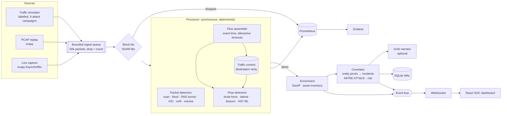
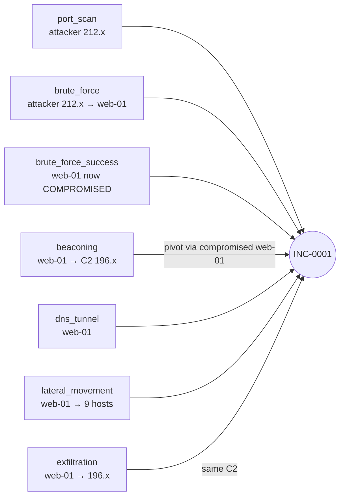

# Architecture

This document follows a single packet through ThreatPulse AI and explains the reasoning
behind each stage. For *why* the project exists, see [ANALYSIS.md](ANALYSIS.md).

## 1. System overview

## 2. Stages

### 2.1 Sources (`threatpulse/sources/`)
| Source | File | Notes |
|---|---|---|
| Simulator | `simulator.py` | Virtual-time generator. Benign profiles (browsing with DNS, SMB/LDAP, web tier → DB, telemetry heartbeats, NTP, SMTP, admin SSH) plus attack campaigns. Every packet carries a hidden ground-truth label. |
| PCAP | `capture.py::read_pcap` | Streams a capture with `PcapReader` (constant memory). Paced by the capture's own timestamps, or as fast as possible with `--speed 0`. |
| Live | `capture.py::live_capture` | scapy `AsyncSniffer` in a thread, handed to the event loop with `call_soon_threadsafe`. |

All sources produce the same `Packet` dataclass (`models.py`), so nothing downstream knows
where traffic came from.

### 2.2 Backpressure (`engine.py`)
The producer and consumer are separate asyncio tasks joined by a bounded `asyncio.Queue`.
Live traffic that arrives faster than detection can handle is **dropped and counted**
(`threatpulse_dropped_packets_total{reason="queue_full"}`) instead of growing memory. PCAP
replay waits instead, because a file can always be paused.

### 2.3 Flow assembly (`pipeline/flows.py`)
* Canonical bidirectional key `(proto, low endpoint, high endpoint)`. Orientation comes from the first packet.
* Termination on FIN+FIN or RST, plus a short TIME_WAIT cache so trailing ACKs don't open junk flows.
* Idle timeout (TCP 30 s, UDP 15 s) and active timeout (60 s, partial records for long transfers).
* The table is an `OrderedDict` kept in last-seen order, so sweeping expired flows is
  O(expired), not O(table). The table is capped, with LRU eviction.
* **Event time:** expiry is driven by the packet-timestamp watermark, never `time.time()`.

### 2.4 Detection (`detection/`)
Four layers that catch different things:

| Layer | Detectors | What it catches |
|---|---|---|
| Stateful rules | `rules.py`: PortScan, SynFlood, BruteForce(+success), LateralMovement, Exfiltration | Known attack *shapes*, which still show up when traffic is encrypted |
| Behavioural | `behavior.py`: Beacon, DnsTunnel | Timing periodicity and information-theoretic signals |
| Threat intel | `intel.py`: IocDetector | IPs, CIDRs and domains from feeds |
| Online ML | `anomaly.py`: Half-Space Trees, EWMA volume | Unknown unknowns |

Shared building blocks (`base.py`):
* `WindowedSet` / `WindowedCounter`: sliding event-time windows with amortised O(1) updates.
* `Detector.ready/cooling`: per-key cooldowns, so a 10-minute attack produces one alert, not 10,000.
* `TrafficContext.rarity(dst)`: how many internal hosts talked to an external IP in the last
  hour. This one number removes most beaconing and exfiltration false positives, because
  legitimate SaaS is contacted by everyone and C2 by one host.

### 2.5 Half-Space Trees (`detection/anomaly.py`)
Streaming HS-Trees (Tan, Ting & Liu, 2011), written from scratch with numpy:

1. Each of the 25 trees splits a random dimension at the midpoint of a randomly perturbed
   work range. The structure is built **without looking at data**.
2. Each node holds two mass counters: `ref` (the last full window) and `latest` (filling now).
   Every 256 points they swap. This is how the model forgets old traffic and adapts to drift.
3. Score = Σ over trees of `mass(terminal node) · 2^depth`. Points in sparse regions stop
   early with little mass, so their score is low. ThreatPulse log-normalises the score to [0, 1]
   and inverts it (high = anomalous).
4. Traversal is vectorised across all trees at once (one numpy op per depth level).
5. The alert threshold is the 99.8th percentile of recent scores. Flows above it are **not
   learned from**, which stops the model from learning the attack as normal.

ML alerts are rate-limited and treated as *supporting evidence* (see 2.6).

### 2.6 Correlation (`correlation/engine.py`)
Alerts are folded into incidents by **entity linking with union-find merge semantics**:

* Link keys are the attacker IP and external peers (C2 servers, exfil endpoints, bad domains).
* Internal hosts become link keys only when **compromised**: after a successful login lands
  on them, or once they emit high-confidence malicious traffic themselves. Victims of
  *failed* attacks are not pivots, so two unrelated attackers hitting one busy web server
  stay two incidents.
* If an alert matches two incidents, they **merge**.
* `flow_anomaly` and `volume_anomaly` can enrich an incident but never open one, and they
  don't count as ATT&CK tactics.
* Risk = peak alert score + 6 per extra tactic + kill-chain depth + compromise bonus, scaled
  by the most critical affected asset (from `config/assets.yaml`).

### 2.7 Explanation and response
* `correlation/engine.py::template_summary` writes a deterministic analyst briefing.
* `intel/llm.py` sends the incident JSON to Grok (xAI, OpenAI-compatible API) for a natural
  language briefing when `XAI_API_KEY` is set. Calls are debounced: only when an incident
  gains a new tactic or severity, and at most once per 15 s per incident. The LLM never
  decides *whether* something is an attack.
* `response/blocklist.py`: blocked IPs are dropped at ingest, and each block shows matching
  `iptables`/`nft` commands for real infrastructure.

### 2.8 Delivery
* `bus.py`: per-subscriber bounded queues with drop-oldest, so a slow browser tab can never stall detection.
* `api/app.py`: REST for queries and control, `/ws` streams a snapshot followed by batched events.
* `observability/metrics.py`: counters, gauges and a latency histogram on `/metrics`.
* `storage/store.py`: buffered batch writes to SQLite in WAL mode from a worker thread.

## 3. Design trade-offs

| Choice | Alternative | Why |
|---|---|---|
| Single process, in-proc bus | Kafka + microservices | The demo runs with one command. `Processor` is pure and synchronous, so sharding by flow key across workers or Kafka partitions is a mechanical change. |
| Python | Rust / Go | ~68k pkt/s with ML on a laptop is plenty for a branch office or for PCAP forensics. The hot paths are O(1) per packet; scaling out is the next step, not rewriting. |
| Heuristic + statistical detectors | Supervised deep learning on CICIDS | Supervised models trained on old datasets transfer poorly to live networks and can't explain themselves. Every ThreatPulse alert carries its evidence. |
| Event time everywhere | Wall-clock timers | Deterministic tests, and PCAP replays behave exactly like live traffic. |
| Simulator with ground truth | Only public PCAPs | Lets CI *measure* recall and false-positive rate on every commit. |

## 4. Scaling path
1. Run N processors, each consuming a Kafka partition keyed by `hash(flow_key)`.
   Per-source detectors (scan, beacon) key by source IP, which is consistent with that partitioning.
2. Move `Correlator` state to Redis (entity index plus incidents) so it can be shared.
3. Swap SQLite for Postgres/TimescaleDB or ClickHouse for long-term flow retention.
4. Feed Zeek `conn.log`/`dns.log` as an additional source; the `Packet`/`Flow` model already maps onto it.
